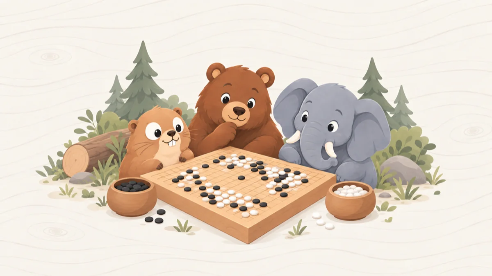

# Nine-by-Nine Go



<div>
<a href="https://github.com/volodymyr-pavlov/go-game/actions/workflows/ci.yml"></a>
<a href="https://github.com/volodymyr-pavlov/go-game/releases"></a>
<a href="packages/engine/go.mod"></a>
<a href="LICENSE"></a>
</div>

A 9x9 game of Go in your browser. You play against Gopher, Bear or Elephant, three levels of an engine that runs _inside_ your browser.

**Play it here:** https://go-game.volodymyr-pavlov-13.workers.dev/

## What is this?

Go is the oldest board game that people still play the way it was made: black and white stones, a grid, and one
rule that matters (a group with no free points next to it is taken off the board). It is easy to learn and very
hard to master. The 9x9 board is the small version. A game takes ten minutes, not two hours, and it is still a
real fight.

The opponent is a Monte Carlo Tree Search engine written in Go. No server thinks for it. The engine is compiled to
WebAssembly and plays thousands of random games in a Web Worker while you wait. Gopher runs 200 playouts, Bear 500
and Elephant 1000. Even Elephant answers in well under a second.

## What you can do

- **Play Gopher, Bear or Elephant** as Black or White, or play a friend at the same keyboard.
- **Pass**, **resign**, or start a **new game**.
- Confetti when you win. Yes, confetti.

Accounts, a leaderboard by Elo rating and online play in rooms are built, but they are switched off in the released
game. They come next, and they need a Firebase project and the game server in `apps/api`. Without them, the game
just opens and you play the engine.

## How it is built

- **Engine:** Go, compiled to WebAssembly. The hot path allocates nothing: a neighbour table by index, a flood-fill
  scratch that is reused, and playouts played in place on one board. The engine is `packages/engine/game`, and `packages/engine/wire` is
  the JSON layer between it and the web app.
- **Board:** PixiJS v8 on a canvas. Stones pop in and out, and the board resizes with the window. A skin is a set
  of colours plus optional textures and a sound. Skins are listed in `apps/web/src/presentation/skins/SkinRegistry.ts` and
  loaded from `apps/web/public/skins/` through a PixiJS Assets manifest. Without textures, the board is drawn from colours.
- **App:** TypeScript with Vite and Tailwind. The rules exist twice on purpose. The Go engine has them for the
  search, and a small TypeScript copy checks your clicks and scores the game without waking the engine.
- **Sign-in:** Firebase Auth (anonymous, with an optional email link). It does nothing else.
- **Game server:** a Cloudflare Worker in `apps/api/` (Hono). D1 keeps the players, the nicknames and the games. One
  Durable Object per online game keeps the moves, checks every one with the same rules as the browser, and works out
  the result and the Elo change itself. The Worker checks the Firebase ID token of every call. The same Worker serves
  the built site.
- **Tests:** Go tests and a benchmark for the engine, Vitest for the app and the Worker, and Playwright clicking the
  real board, with two players in two browsers for online play.

## Run it yourself

You need Node.js 24+ and Go 1.27+.

```sh
npm install
npm run dev        # Turborepo: compiles the engine to wasm, then starts Vite on http://localhost:5173
npm run build      # production build in apps/web/.dist/, a static site any host can serve
npm test           # Vitest in every package, then go vet and go test
npm run check      # typecheck, tests, Prettier and the TSDoc check; Turborepo caches what did not change
npm run dev:tma    # the Telegram Mini App on http://localhost:5174 (and dev:youtube on 5175)
npm run test:e2e   # Playwright through the real page (run npx playwright install chromium once)
```

Do you want the accounts, the leaderboard and online play on your machine? You need three things running:

```sh
npm run firebase:auth-emulator               # the Firebase Auth emulator (no Java needed)
npm run cloudflare:migrate:local && npm run cloudflare:dev   # the game server on http://localhost:8787
npm run dev                     # the page; Vite sends /api to the game server
```

In `.env` put a project ID that starts with `demo-`, `VITE_FIREBASE_EMULATOR=127.0.0.1` and `DEV_AUTH=1` (see
`.env.example`). `DEV_AUTH` lets the game server take the emulator's tokens.
`npm run test:e2e:firebase` starts all of it by itself. Nothing is kept when the emulator stops, so every nickname is
free again.

## Production setup

**The game alone (1.0.0).** It is a static site on Cloudflare. The `wrangler` command comes with `npm install`.

1. `npx wrangler login`. The first deploy creates the site, and it gets the address
   `https://go-game.<your-subdomain>.workers.dev`.
2. `npm run build`, then `npx wrangler deploy --config apps/web/wrangler.jsonc` puts `apps/web/.dist/` online.
3. In GitHub, Settings > Secrets and variables > Actions: the secrets `CLOUDFLARE_API_TOKEN` (made from the "Edit
   Cloudflare Workers" template) and `CLOUDFLARE_ACCOUNT_ID`, and optionally the variable `VITE_GA4_ID`. Do not set the `VITE_FIREBASE_*` variables yet.

The workflow in `.github/workflows/ci.yml` runs the checks (`check-web`, `test-engine`, `build-engine`, `e2e`) and the
`build` on every pull request, push to `main` and tag. A push to `main` runs `deploy`, which puts the build online. A
`git tag -a vX.Y.Z` (see `CONTRIBUTING.md`) runs `release`, which publishes the GitHub Release from `CHANGELOG.md`.

**Accounts, the leaderboard and online play (next).** They need sign-in from Firebase and the game server on
Cloudflare. Sign-in, once per Firebase project, in the console at https://console.firebase.google.com:

1. **Authentication:** Build > Authentication > Get started, then Sign-in method: turn on **Anonymous** and
   **Email/Password**. Without Anonymous, the guest button fails with `auth/configuration-not-found`.
2. **Web app config:** Project settings > General > Your apps > Web app. Copy the values into `.env` for local
   builds and into the repository variables (`VITE_FIREBASE_*`) for the built site. Without them the site has no accounts,
   no leaderboard and no online play: it opens straight on the board.
3. **Authorized domains:** Authentication > Settings, add the address of the site.

The game server, once per Cloudflare account:

1. `npx wrangler d1 create go-game`. Put the `database_id` it prints into `apps/api/wrangler.jsonc`. The Firebase
   project ID in that file must be yours too.
2. `npx wrangler d1 migrations apply DB --remote --config apps/api/wrangler.jsonc` creates the tables. Run it again
   after every new file in `apps/api/migrations/`.
3. In the Cloudflare dashboard, Turnstile > Add widget for the address of the site. Put its site key in
   `VITE_TURNSTILE_SITE_KEY` (in `.env` and in the repository variables), and its secret in the Worker:
   `npx wrangler secret put TURNSTILE_SECRET --config apps/api/wrangler.jsonc`. A Worker without the secret refuses
   every write that Turnstile checks: a nickname, a new room, a join.
4. `npm run build`, then `npx wrangler deploy --config apps/api/wrangler.jsonc` puts the Worker and the site online.
   Never set `DEV_AUTH` on the deployed Worker: it lets anyone sign in as anyone. In Actions, the "Deploy by hand" workflow
   (`.github/workflows/deploy.yml`) with the target `api` does this; give the API token the "D1: Edit" permission too.

Optional: a Google Analytics 4 measurement ID in `VITE_GA4_ID` turns on the consent bar.

The result of an online game is worked out on the server, from the moves it checked itself. A player has five minutes
for a move (`TURN_TIMEOUT_MS` in `apps/api/src/onlineGame.ts`). After that the game is lost on time, so a player who
left does not hold the game for ever. A game against the engine
is still reported by the browser, because the engine runs in the browser, so the server cannot check it. It works out
the rating change itself, and allows one result every 30 seconds.

## Where things are

```
go-game/
├── apps/
│   ├── web/                    # the page in a browser: Vite, Tailwind, Firebase Auth, the DOM pages and the side panel
│   │   ├── src/                # main.ts, firebase/, ui/, analytics/, styles/
│   │   ├── e2e/                # Playwright: gameplay on the real board, accounts and online play against the emulator
│   │   ├── public/             # served as is: privacy and terms, skins/, and the compiled engine
│   │   └── firebase/           # firebase.json: the Auth emulator
│   ├── api/                    # the game server, Hono on a Cloudflare Worker
│   │   ├── migrations/         # D1 SQL migrations
│   │   └── src/                # index.ts, app.ts, middleware/ (auth, rate limit), routes/ (auth, leaderboard, match, rooms, stars), services/ (D1, tokens, Turnstile), rooms/ (the Durable Object)
│   ├── tma/                    # the Telegram Mini App: the SDK, Stars, and a touch UI around the shared board
│   └── youtube/                # the YouTube Playable: the ytgame SDK and a canvas-first overlay
├── packages/
│   ├── engine/                 # Go: rules, the tree search, the JSON layer, and build.sh that compiles the wasm for every app
│   ├── presentation/           # PixiJS: the board scene, stones and overlays, the skins, and `mountEngineGame` for the apps with no side panel
│   ├── bridge/                 # the Web Worker that runs the wasm engine, and the typed messages to it
│   ├── types/                  # the flags, the game words and the contract of the game server (DTOs)
│   ├── core/                   # the game in TypeScript with no browser: rules, scoring, Elo, the game loop and its ports
│   ├── client/                 # calls to the game server: the leaderboard, the nicknames, live rooms over WebSocket
│   └── tsconfig/               # the base, DOM and Worker TypeScript configs
├── docs/                       # the cover picture of this README
├── scripts/                    # check-tsdoc.mjs, sync-skins.mjs
├── turbo.json                  # the tasks Turborepo runs, and in which order
└── .github/workflows/          # ci.yml: tests, e2e, build, Cloudflare deploy, release on tags; deploy.yml: by hand
```

`packages/core` and `packages/client` are not in the sketch the layout came from. The rules and the client are shared by all
three apps, and the game server checks online moves with the same rules, so they are packages of their own. The packages are
plain TypeScript that the apps import from source (`@go-game/core/board.ts`), so there is no build step for them. The
Telegram sign-in is one more way in for the same server: `Authorization: tma <initData>`, checked in
`apps/api/src/middleware/auth.ts`.

Fixes are welcome, see `CONTRIBUTING.md`. MIT licensed. The licenses of the fonts and libraries that ship with the build are in `apps/web/public/third-party-licenses.txt`.
